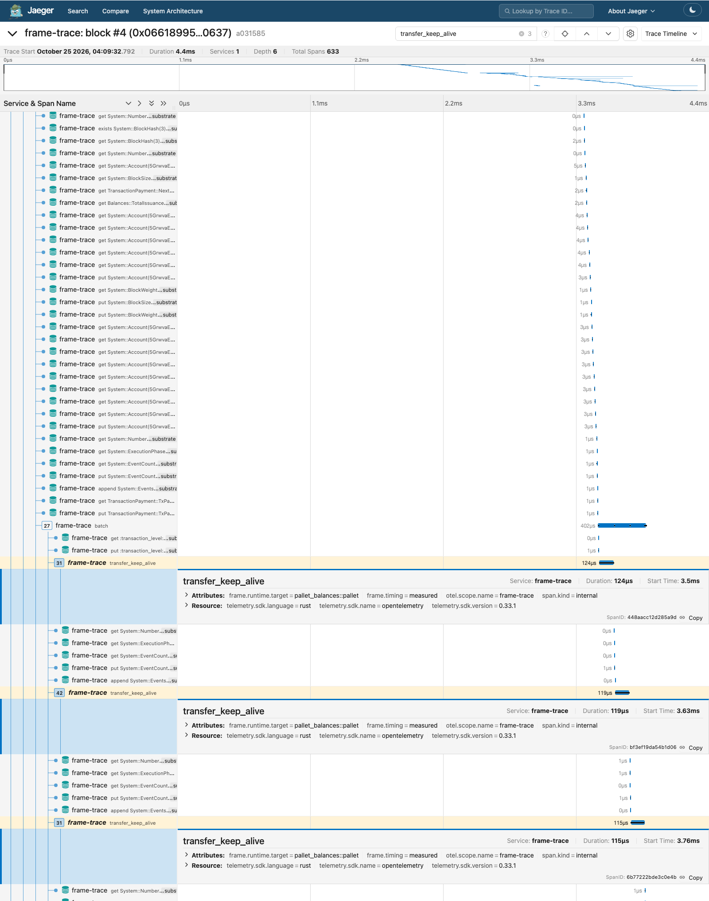

# frame-trace

Replay a Polkadot SDK block and view its storage accesses in Jaeger or Tempo.
Self-replay uses safe RPC and authenticated parent-state proofs. The SDK executes
`Core_execute_block`, including signatures and the real storage-root assertion.



Build with the pinned Rust toolchain. The first build compiles the SDK executor.

```sh
cargo +1.93.0 build --release --locked
cargo +1.93.0 test --workspace --locked
cargo +1.93.0 clippy --workspace --all-targets --locked -- -D warnings
```

Start Jaeger. Open http://127.0.0.1:16686 and select service `frame-trace`.

```sh
docker run --rm -p 16686:16686 -p 4318:4318 jaegertracing/jaeger:latest
```

Trace the current best Westend Asset Hub block. A decimal number or full hash also
works. Older blocks may need an archive endpoint.

```sh
target/release/frame-trace block \
  --rpc wss://westend-asset-hub-rpc.polkadot.io --block best \
  --save saved-block --otlp http://127.0.0.1:4318 --json block.json

target/release/frame-trace block --offline saved-block --otlp http://127.0.0.1:4318
target/release/frame-trace summary --offline saved-block
target/release/frame-trace summary \
  --rpc wss://westend-asset-hub-rpc.polkadot.io --block best

target/release/frame-trace follow \
  --rpc wss://westend-asset-hub-rpc.polkadot.io --otlp http://127.0.0.1:4318
```

Each replay prints the computed and header state roots, their comparison and RPC count.
Discovery batches up to 32 predicted storage keys per proof and uses eight concurrent
requests by default (`--proof-concurrency 1..64`). Metadata storage prefixes,
previous blocks' full-key hints and up to eight discarded speculative executions
provide the predictions. Branch misses also batch immediate sibling paths needed
by trie-root calculation and iteration. A strict authenticated discovery run follows; speculative
outputs are never exported or accepted. Progress is printed during proof acquisition
and runtime compilation/loading.
The measured run uses a warm cache and zero RPC. A missing proof is an error.
Offline replay never creates an RPC client. HTTP(S) endpoints also work.

`follow` polls best headers every two seconds and walks changing best ancestry.
Two workers share authenticated content-addressed nodes (bounded to 256 MiB),
full-key hints and compiled runtimes keyed by code hash. Each block authenticates
nodes by traversal from its own parent state root. Fresh overlays and recorders
preserve proof sizes. `--cache-dir DIR` also persists proof nodes and Wasmtime's
compiled-module cache. Without it, compiled modules persist under
`$XDG_CACHE_HOME/frame-trace/wasm` (or `~/.cache/frame-trace/wasm`); proof nodes
remain in memory. Offline artifacts always supply their own proof nodes.

An eight-block queue bounds pending work. Queued, in-flight, done and failed
counts are reported. Failed blocks retry with capped backoff while retained in a
256-block history; queue-full blocks remain eligible for later polls. Ancestry
walks stop at 64 blocks. **Follow samples at replay speed when it cannot keep up**;
it does not guarantee every block or track finality. Best blocks can be reverted.
RPC calls retry transient timeouts, dropped connections, HTTP 429/5xx and RPC rate
limits, up to four attempts with capped exponential backoff and jitter. DNS/TCP/
TLS/WebSocket setup has a ten-second deadline and the whole call, including pool
wait and retries, has a thirty-second deadline. HTTP and WS use the same WebPKI
root store. Ctrl-C cancels outstanding RPC immediately; a second Ctrl-C forces
exit. Shutdown does not wait for SDK compilation or collector I/O.

Times are measured on the replay machine, including tracing overhead. They are
not the original node's database latency or benchmark weights. Runtime spans
appear when the Wasm has `with-tracing`. Without them, ops sit under phase spans.
Backend iteration events describe attempts; the overlay may change the result.
Named phases retain their statistics and parent runtime dispatch/hook spans and
storage operations in one tree. The runtime's whole-block wrapper is represented
by the block span. Only traced `apply_extrinsic` spans carry
`frame.proof.marginal_bytes`, the recorder's growth during that span. These are
not standalone extrinsic proof sizes.

Names require metadata V14 or newer. Missing, malformed or unsupported metadata
produces a warning and undecoded names; a passed replay is still saved/exported.

Recorded `state_traceBlock` JSON remains available as a secondary source. Its
timestamps are synthetic. Metadata is optional for this source.

```sh
target/release/frame-trace summary \
  --from-file fixtures/model/two-extrinsics.json \
  --metadata fixtures/metadata/westend-v16.scale
```

Replay supports SDK Blake2 headers with u32 block numbers. Unknown host imports,
missing extensions and root mismatches fail. Proof-size-sensitive execution is
accepted only if the real root check passes. Public acquisition can take many
proof round trips. No node-wide state scrape or unsafe RPC is used.

The executor uses the [stable2609 SDK release](https://github.com/paritytech/polkadot-sdk/releases/tag/polkadot-stable2609):
`sc-executor 0.51.0`, `sp-io/sp-runtime 49.0.0`, `sp-trie 47.0.0`,
`sp-state-machine 0.54.0`. Its host families match omni-node: Substrate, proof size,
statement store and RFC163 elliptic curves. Offline tests execute both E1's
stable2606-2 People runtimes and the public Westend runtime with that set.

See [SPEC.md](SPEC.md), [artifact format](crates/replay/ARTIFACT.md) and
[fixture provenance](fixtures/replay/README.md).

Artifact loading limits decompressed JSON to 64 MiB, proof nodes to 100,000 and
total decoded proof bytes to 24 MiB. Fixture blobs are limited to 16 MiB each;
errors identify the affected file. `--save` artifacts remain self-contained.

The workspace's `[profile.dev] debug = 0` omits debug symbols to keep the SDK /
Wasmtime development build within practical disk and linker-memory limits. It
does not change execution optimizations. Use release builds for throughput and
change the profile locally when native debugger symbols are needed.

[Replay fix-round measurements](crates/replay/PERFORMANCE.md) record cold/warm
replay, two-minute follow throughput, offline summary timings and exact test counts.
