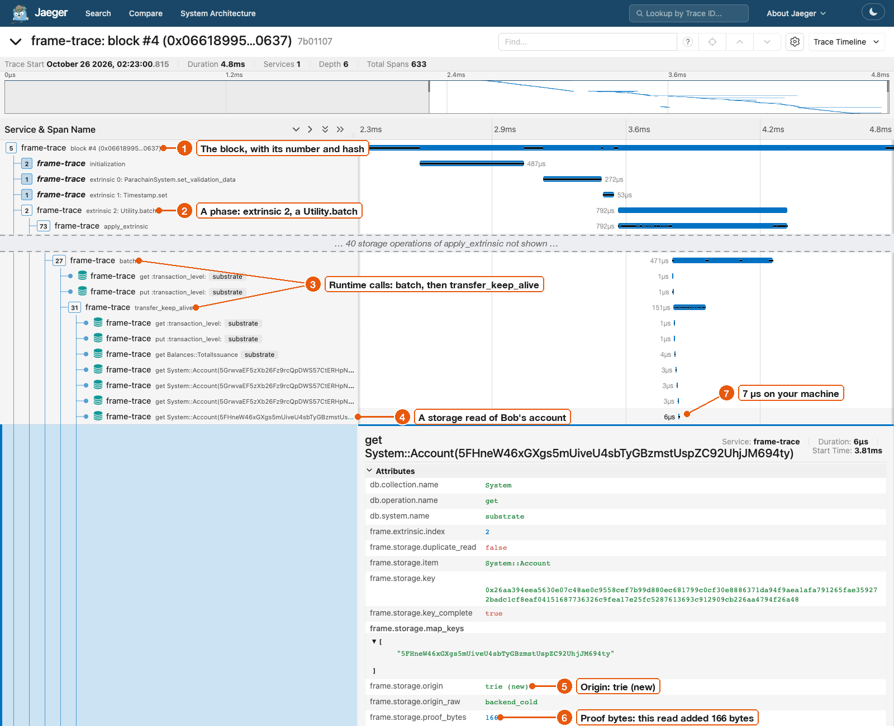

# frame-trace

Replay any block of a Polkadot SDK chain on your machine and see every storage read and write as a trace.



*Block #4 of a People chain in Jaeger: (1) the block, (2) the `Utility.batch` extrinsic, (3) the runtime calls inside it, (4) a read of Bob's account, (5) where it was answered, (6) the bytes it added to the proof, (7) its duration.*

## What you get

- **Every storage read and write of a block**, in order, with decoded names such as `System::Account(5Grw…)`.
- **Why each read cost what it did**: answered from the block's own cache or from the trie, and how many bytes it added to the block's proof.
- **The busiest storage items, repeated reads and costs per extrinsic**, for one block or a range of thousands.
- **A trace you can trust.** frame-trace checks every value it fetches against the chain's state root. After the replay, the root check confirms your machine reached the same state as the chain.

It works with any node over normal RPC. You need no unsafe methods and no special node build.

## Five-minute start

Install frame-trace. The first build takes several minutes.

```sh
git clone https://github.com/agustinustheo/frame-trace
cd frame-trace
cargo install --locked --path crates/cli
```

Start Jaeger:

```sh
docker run -d --rm --name jaeger -p 16686:16686 -p 4318:4318 jaegertracing/jaeger:latest
```

Trace the latest finalized Westend Asset Hub block and send it to Jaeger:

```sh
frame-trace block --rpc wss://westend-asset-hub-rpc.polkadot.io --block finalized --otlp
```

You should see this. Your block number and sizes will differ.

```text
replay #18597850: fetching state (up to 8 concurrent proof requests)
replay #18597850: loading runtime and preparing state
root check: PASS; RPC calls: 92 (timed replay: 0); execution proof: 90250 bytes
fetching state #18597850: 63 proof request rounds; 92 RPC calls
state root: computed 0xd38db8182fdc90a095595bb7a57fb30af7770e10effe0b217866132a2032663c; header 0xd38db8182fdc90a095595bb7a57fb30af7770e10effe0b217866132a2032663c
exported 555 spans to http://127.0.0.1:4318
```

`root check: PASS` means the replay produced the same state root as the block header.
So the trace shows what the block really did.

Open <http://127.0.0.1:16686>, pick the service `frame-trace` and click **Find Traces**.
Open the trace `frame-trace: block #<number>`.
You will see the block's phases: initialization, the required extrinsics, post inherents and finalization.
Each phase holds its storage reads and writes.
Click any read to see where it was answered and its proof bytes.

## Learn more

The [documentation](docs/README.md) has:

- **Getting started:** [install](docs/getting-started/install.md), [your first trace](docs/getting-started/first-trace.md), [reading a trace](docs/getting-started/reading-a-trace.md).
- **Guides** named after the job: [find repeated reads](docs/guides/find-repeated-reads.md), [measure proof size](docs/guides/measure-proof-size.md), [trace a runtime API call](docs/guides/trace-a-runtime-api-call.md), [analyse many blocks](docs/guides/analyse-many-blocks.md) and [more](docs/SUMMARY.md).
- **Concepts:** [what a replay proves](docs/concepts/what-a-replay-proves.md), [phases](docs/concepts/phases.md), [cache or trie](docs/concepts/cache-or-trie.md), [proof bytes](docs/concepts/proof-bytes.md), [timings](docs/concepts/timings.md).
- **Reference:** [commands and flags](docs/reference/commands.md), [span attributes](docs/reference/spans.md), [JSON output](docs/reference/json.md).
- **[Troubleshooting](docs/troubleshooting.md)**, one section per error message.

## Requirements

- Rust 1.93.0. `rust-toolchain.toml` pins it and `rustup` installs it.
- The RPC URL of a node for the chain. For old blocks, the node must keep their state, so use an archive node.
- A Polkadot SDK chain with Blake2 headers and `u32` block numbers. Decoded names need metadata V14 or newer.
- Docker, or any trace viewer that accepts OTLP over HTTP. JSON output needs neither.

## Contributing

Internal notes, research and design documents are in [`dev/`](dev/README.md).
Run `cargo test --workspace` before sending a change.
Docs follow [docs/STYLE.md](docs/STYLE.md). Build them with `mdbook build`, which needs `mdbook` and `mdbook-mermaid`.

## License

Apache-2.0.
