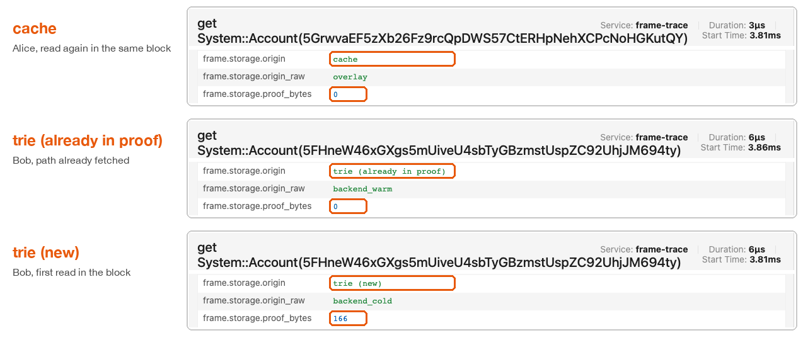

# Cache or trie

Every storage read has an **origin**: where the runtime got the value.
There are three origins.

| Origin | Meaning | Proof bytes |
| --- | --- | --- |
| **cache** | The block had already written this key, so the value came from the block's own changes in memory. | Always 0 |
| **trie (already in proof)** | The read went to the chain state. Every trie node on its path was already in this block's proof. | Usually 0 |
| **trie (new)** | The read went to the chain state and needed trie nodes the block had not touched yet. | Usually more than 0 |
| **unknown** | Not a read, or the input had no origin, for example a recorded `state_traceBlock` file. | n/a |

## Three real reads

These three reads come from the first `transfer_keep_alive` in block #4 of the People fixture.
Alice sends to Bob.



- **cache.** Alice's account was written earlier in the block, when her fee was taken.
  Every later read of her account comes from that write in memory.
  It costs no proof bytes.
- **trie (new).** This is the first time the block reads Bob's account.
  The runtime walks the trie from the state root down to Bob's entry.
  Some nodes on that path were new to the block, so the read added 166 proof bytes.
- **trie (already in proof).** The runtime reads Bob's account again, before anything writes it.
  It walks the trie again, but every node is already in the proof.
  It adds 0 proof bytes.

## Reading does not fill the cache

Only a write puts a key in the cache.
Reading a key twice goes to the trie twice.
That is why this transfer reads Bob's account from the trie eight times: once new, then seven times already in proof.
After the transfer writes Bob's balance, his next reads come from the cache.

## What the origin does not tell you

- **trie** does not mean a disk read.
  A real node has its own caches below the runtime.
  The origin only says the runtime asked the chain state instead of its own pending changes.
- **cache** does not mean free.
  The runtime still makes a host call and copies the value.
  It shows up in `storage time` like any other read.
- The origin does not tell you whether a read is safe to remove.

## Where you see origins

- In Jaeger, on every storage operation: `frame.storage.origin`, with the same words as the tables.
- In [JSON](../reference/json.md), as `origin`, with its own stable values.
- In `summary` and `report`: the columns `reads: cache`, `trie (already in proof)`, `trie (new)` and `unknown`.
- In the summary line, for example:

```text
1 block(s); 518 operations; reads 312 = cache 231 + trie 81 (already in proof 47, new 34) + unknown 0
```

That line says block #4 made 312 reads.
231 came from the cache.
81 went to the trie: 47 found their path already in the proof and 34 added new nodes.

[Find repeated reads](../guides/find-repeated-reads.md) puts these numbers to work.
