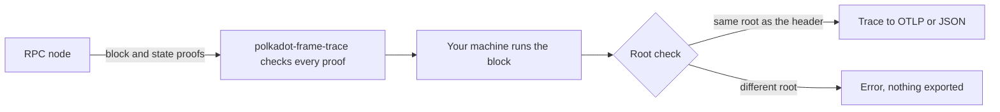

# What a replay proves

A **replay** runs a block again on your machine, with the chain's own runtime.
polkadot-frame-trace records every storage call during the replay.
At the end, it does the **root check**: the replay must give the same state root as the block header.
If the roots are the same, the trace shows what the block really did to storage.



## The steps

1. **Fetch.** polkadot-frame-trace gets the block and its parent header from the node with normal RPC methods.
   It uses no unsafe methods. The node must still have the state of the parent block.
2. **Check the proofs.** polkadot-frame-trace gets a proof for each storage value that the block needs.
   It checks each proof against the parent's state root before it uses the value.
   The runtime code, `:code`, gets the same check.
3. **Run the block.** Your machine runs `Core_execute_block` with that runtime.
   Signature checks and the runtime's own final checks stay on.
4. **Root check.** The runtime calculates the new state root.
   polkadot-frame-trace compares it with the root in the block header, and prints both roots.
5. **Export.** polkadot-frame-trace sends the trace to OTLP or writes JSON only after a pass.

Before the final replay, polkadot-frame-trace finds and gets the state that the block reads.
To find that state, it may run the block more than once.
Then it does a last **timed replay**. This replay uses only the state it already has, and makes no network calls.
The trace and its times come from the timed replay.
That is why the output says `RPC calls: 92 (timed replay: 0)`.

## Reading the output lines

```text
root check: PASS; RPC calls: 92 (timed replay: 0); execution proof: 93271 bytes
fetching state #18597014: 64 proof request rounds; 92 RPC calls
state root: computed 0xb87876c14cd3a062965fc43788f5e3670d555300c80c370736e615519b53f794; header 0xb87876c14cd3a062965fc43788f5e3670d555300c80c370736e615519b53f794
```

| Field | Meaning |
| --- | --- |
| `root check: PASS` | The computed state root equals the header's state root. |
| `RPC calls: 92` | Requests sent to the node for this block. |
| `(timed replay: 0)` | Requests sent during the timed replay. Always 0 on success. |
| `execution proof: 93271 bytes` | Size of the storage proof for the whole block. See [Proof bytes](proof-bytes.md). |
| `64 proof request rounds` | Times polkadot-frame-trace went back to the node for more state. Each round can hold many keys. |
| `state root: computed …; header …` | The two roots side by side. |

When the root check fails, polkadot-frame-trace stops with an error and exports nothing.
[Troubleshooting](../troubleshooting.md#runtime-execution-failed-root-mismatch-unsupported-host-function-or-invalid-block) lists the causes.

## What a pass means

- Each value that the block read came from the real parent state. A proof checked each value.
- The runtime that ran is the runtime on chain, unless you used a [runtime override](../guides/see-runtime-calls.md).
- The writes of the block give the same state root that the chain recorded.
  Thus the reads and writes in the trace are complete, and in the real order.

## Runtime upgrades

A block always runs with the runtime in the state of its parent.
A block that upgrades the runtime runs on the old code, and writes the new `:code`.
The next block is the first block that runs the new code.
The storage and extrinsic names in each trace come from the runtime that ran that block.

## What a pass does not mean

- It does not check consensus.
  polkadot-frame-trace trusts the node to send a block header from the correct chain.
  The root check proves that the block agrees with that header. It does not prove that the header is finalized.
- Timings are from your machine.
  They are not the node's import time, its database speed or the block's weight.
  See [Timings](timings.md).
- With `--runtime-override`, a pass shows that the other runtime wrote the same state.
  The spans and times then show the other runtime, and the output says so.

## Runtime API calls have no root check

`polkadot-frame-trace call` runs a runtime API, such as `AccountNonceApi_account_nonce`, against a block's state.
A call does not produce a new block, so there is no root to compare.
Every value it reads is still checked by proof against that block's state root.
The output says `root check: NOT APPLICABLE (runtime API call)`.
`--check-state-call` compares the result with the node's own `state_call`.
See [Trace a runtime API call](../guides/trace-a-runtime-api-call.md).

## Recorded traces have no root check

`--from-file` reads a response saved from the node's `state_traceBlock` method.
polkadot-frame-trace does not replay that block, so there is no root check, no origin and no proof bytes.
