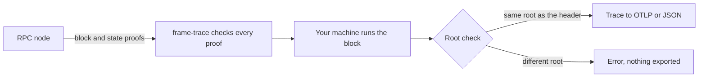

# What a replay proves

A **replay** runs a block again on your machine.
frame-trace replays the block with the chain's own runtime and records every storage call.
At the end it runs the **root check**: the replay must produce the same state root as the block header.
If it does, the trace shows what the block really did to storage.



## The steps

1. **Fetch.** frame-trace asks the node for the block and its parent header with normal RPC methods.
   It needs no unsafe methods. The node must still keep the parent block's state.
2. **Check the proofs.** For every storage value the block needs, frame-trace asks for a proof.
   Each proof is checked against the parent block's state root before the value is used.
   The runtime code itself, `:code`, comes through the same check.
3. **Run the block.** Your machine executes `Core_execute_block` with that runtime.
   Signature checks and the runtime's own final checks stay on.
4. **Root check.** The runtime computes the new state root.
   frame-trace compares it with the root in the block header and prints both.
5. **Export.** Only after a pass does frame-trace send the trace to OTLP or write JSON.

frame-trace runs the block twice.
The first run fetches the state the block needs.
The second run, the **timed replay**, uses only what the first run fetched and makes no network calls.
The trace and its timings come from the timed replay.
That is why the output says `RPC calls: 92 (timed replay: 0)`.

## Reading the output lines

```text
root check: PASS; RPC calls: 92 (timed replay: 0); execution proof: 93271 bytes
fetching state #18597014: 64 proof request rounds; 92 RPC calls
state root: computed 0xb87876c14cd3a062965fc43788f5e3670d555300c80c370736e615519b53f794; header 0xb87876c14cd3a062965fc43788f5e3670d555300c80c370736e615519b53f794
```

| Field | Meaning |
| --- | --- |
| `root check: PASS` | The computed state root equals the header's state root. |
| `RPC calls: 92` | Requests sent to the node for this block. |
| `(timed replay: 0)` | Requests sent during the timed replay. Always 0 on success. |
| `execution proof: 93271 bytes` | Size of the storage proof for the whole block. See [Proof bytes](proof-bytes.md). |
| `64 proof request rounds` | Times frame-trace went back to the node for more state. Each round can hold many keys. |
| `state root: computed …; header …` | The two roots side by side. |

When the root check fails, frame-trace stops with an error and exports nothing.
[Troubleshooting](../troubleshooting.md#runtime-execution-failed-root-mismatch-unsupported-host-function-or-invalid-block) lists the causes.

## What a pass means

- Every value the block read came from the real parent state, checked by proof.
- The runtime that ran is the one stored on chain, unless you chose a [runtime override](../guides/see-runtime-calls.md).
- The block's writes lead to exactly the state root the chain recorded.
  So the list of reads and writes in the trace is complete and in the real order.

## What a pass does not mean

- It does not check consensus.
  frame-trace trusts the node to give it a block header from the chain you meant.
  The root check proves the block matches that header, not that the header is final.
- Timings are from your machine.
  They are not the node's import time, its database speed or the block's weight.
  See [Timings](timings.md).
- With `--runtime-override`, a pass shows that the substitute runtime wrote the same state.
  The spans and timings then describe the substitute, and the output says so.

## Runtime API calls have no root check

`frame-trace call` runs a runtime API, such as `AccountNonceApi_account_nonce`, against a block's state.
A call does not produce a new block, so there is no root to compare.
Every value it reads is still checked by proof against that block's state root.
The output says `root check: NOT APPLICABLE (runtime API call)`.
`--check-state-call` compares the result with the node's own `state_call`.
See [Trace a runtime API call](../guides/trace-a-runtime-api-call.md).

## Recorded traces have no root check

`--from-file` reads a response saved from the node's `state_traceBlock` method.
frame-trace does not replay that block, so there is no root check, no origin and no proof bytes.
