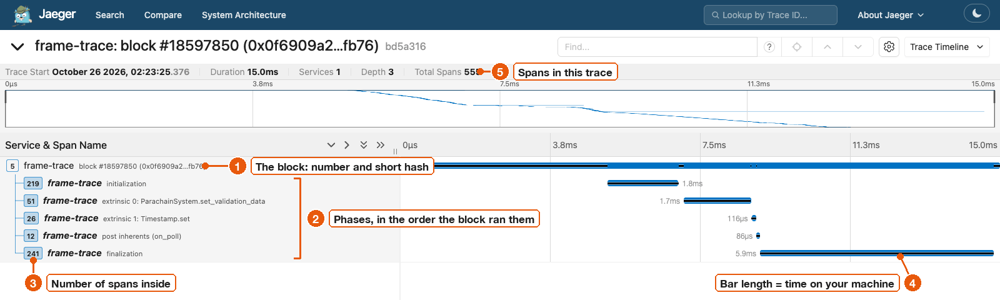

# Your first trace in Jaeger

In five minutes you will trace a live [Westend Asset Hub](../reference/glossary.md#westend-asset-hub) block and open it in Jaeger.
You need frame-trace [installed](install.md) and Docker running.

## 1. Start Jaeger

Run Jaeger in a terminal:

```sh
docker run -d --rm --name jaeger -p 16686:16686 -p 4318:4318 jaegertracing/jaeger:latest
```

Port 16686 is the Jaeger web page.
Port 4318 receives traces over OTLP/HTTP, which is where frame-trace sends them.

## 2. Trace the latest finalized block

```sh
frame-trace block --rpc wss://westend-asset-hub-rpc.polkadot.io --block finalized --otlp
```

`--block finalized` picks the newest block the chain has finalized.
`--block best` picks the newest block the node knows, which may still change.
A block number or a full block hash also works.
`--otlp` with no URL sends the trace to `http://127.0.0.1:4318`.

You should see output like this.
Your block number, byte counts and hashes will differ.

```text
replay #18598757: fetching state (up to 8 concurrent proof requests)
replay #18598757: loading runtime and preparing state
root check: PASS; RPC calls: 93 (timed replay: 0); execution proof: 90712 bytes
fetching state #18598757: 64 proof request rounds; 93 RPC calls
state root: computed 0x4f7fcffe3f0f1aa008fb3b26fd6130215382ff42372400e0dec39c78476164ba; header 0x4f7fcffe3f0f1aa008fb3b26fd6130215382ff42372400e0dec39c78476164ba
exported 555 spans to http://127.0.0.1:4318
```

A run like this took 23 seconds on a laptop with a fresh cache.
Most of that time is spent fetching state from the node.

What the lines mean:

| Line | Meaning |
| --- | --- |
| `fetching state` | frame-trace is asking the node for the storage the block needs, with proofs. |
| `loading runtime and preparing state` | frame-trace is loading the chain's own [runtime](../reference/glossary.md#runtime), taken from the parent block's state. |
| `root check: PASS` | The replay produced the same [state root](../reference/glossary.md#state-root) as the block header. See [What a replay proves](../concepts/what-a-replay-proves.md). |
| `RPC calls: 93 (timed replay: 0)` | 93 requests to the node in total. The timed replay, which the trace comes from, made none. |
| `execution proof: 90712 bytes` | An estimate of the storage proof size for the whole block. See [Proof bytes](../concepts/proof-bytes.md). |
| `64 proof request rounds` | How many times frame-trace had to go back to the node for more state. |
| `state root: computed …; header …` | The root your machine computed, next to the root in the block header. They are equal. |
| `exported 555 spans` | Jaeger accepted all 555 [spans](../reference/glossary.md#span-and-trace): the block, its phases and every storage operation. frame-trace fails if the receiver rejects any span. A receiver can still drop data later, for example through sampling or retention. |

## 3. Open the trace

1. Open <http://127.0.0.1:16686>.
2. In **Service**, pick `frame-trace`.
3. Click **Find Traces**.
4. In the results, click the trace named `frame-trace: block #<number> (0x<first 8 hex digits>…<last 4>)`, for example `frame-trace: block #18598757 (0xb971c31a…8875)`. Jaeger puts the service name in front of the root span name, `block #18598757 (0xb971c31a…8875)`.
5. Click the `>>` button above the span list to collapse everything, then click the block row to open one level.

You should see this:



1. The block span. Its name has the block number and a short hash.
2. The [phases](../concepts/phases.md) of the block, in the order they ran: initialization, the two required extrinsics ([inherents](../reference/glossary.md#inherent)), post inherents and finalization.
   Post inherents is a top-level phase here because this block has only inherents.
   In a block with a user transaction, it sits inside that transaction's extrinsic instead.
3. The badge counts the spans inside each phase. Here those are storage operations.
4. Each bar shows how long the phase took on your machine.
5. The total number of spans in the trace.

The block bar starts before the first phase.
That gap is the runtime starting up on your machine before the block runs.

Westend's runtime is not built with tracing, so storage operations sit directly under each phase.
[See runtime calls inside extrinsics](../guides/see-runtime-calls.md) shows how to get spans such as `batch` and `transfer_keep_alive`.

Leave Jaeger running.
Next: [Reading a trace](reading-a-trace.md) explains every row and attribute, using the same Jaeger.
