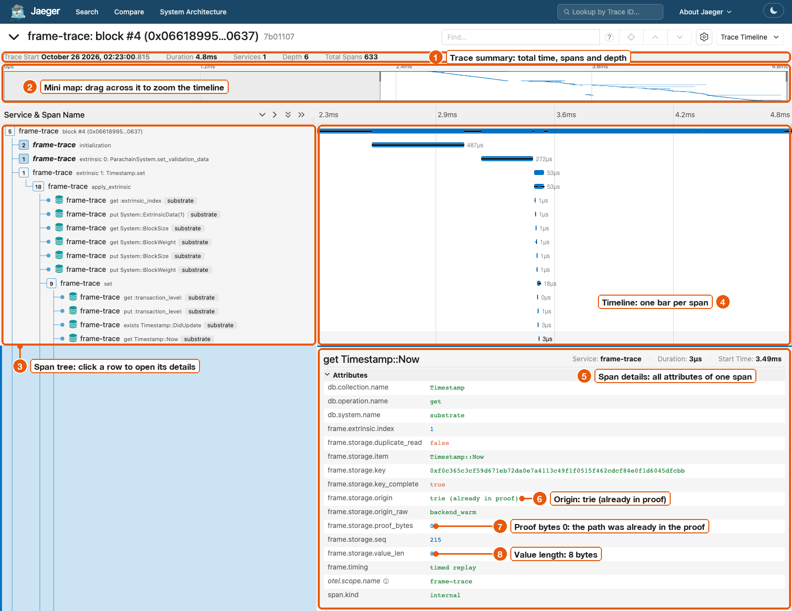
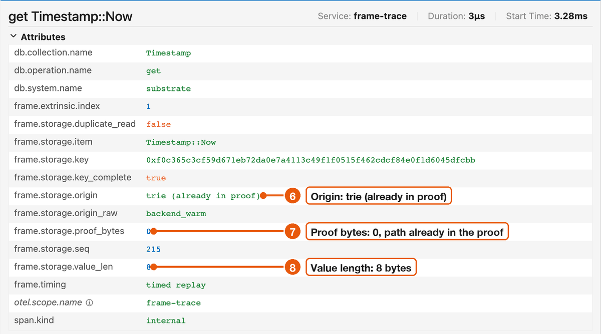

# Reading a trace

This page walks through one trace on screen, region by region.
It uses block #4 of a [People chain](../reference/glossary.md#people-chain), which ships with the repository.
Its runtime was built with tracing, so you also see runtime calls such as `set`.

Send it to Jaeger from the `frame-trace` directory:

```sh
frame-trace block --offline fixtures/replay/people-traced --otlp
```

```text
replay #4: loading runtime and preparing state
root check: PASS; RPC calls: 0 (timed replay: 0); execution proof: 6586 bytes
fetching state #4: 0 proof request rounds; 0 RPC calls
state root: computed 0x47116eac39ac59ba0534a0e4d624f78c4c8c56af5c3084e71c98ca1811e6e4f1; header 0x47116eac39ac59ba0534a0e4d624f78c4c8c56af5c3084e71c98ca1811e6e4f1
exported 633 spans to http://127.0.0.1:4318
```

Open the trace `frame-trace: block #4 (0x06618995…0637)` in Jaeger.
Collapse everything with `>>`, then open `block #4`, `extrinsic 1: Timestamp.set`, `apply_extrinsic` and `set`.
Click the row `get Timestamp::Now`.



## The regions

1. **Trace summary.** Duration is the whole replay on your machine, 4.7 ms here. Total Spans counts every row in the trace.
2. **Mini map.** A small copy of the whole timeline. Drag across it to zoom in. The screenshot is zoomed to the part where the block runs.
3. **Span tree.** One row per span, nested by parent. The badge on a parent counts its children.
4. **Timeline.** One bar per span. The bar starts when the span started and its length is the time it took.
5. **Span details.** Opens when you click a row. It lists every attribute of that span.

## The rows in the span tree

Each row is one of four kinds:

| Row | Example | What it is |
| --- | --- | --- |
| Block | `block #4 (0x06618995…0637)` | The whole block. One per trace. |
| Phase | `extrinsic 1: Timestamp.set` | One [phase](../concepts/phases.md) of the block, here one [extrinsic](../reference/glossary.md#extrinsic). |
| Runtime call | `apply_extrinsic`, `set`, `on_initialize: Aura` | A span the runtime itself reported. Only runtimes built with tracing have these. See [See runtime calls inside extrinsics](../guides/see-runtime-calls.md). |
| Storage operation | `get Timestamp::Now` | One storage call: the operation, then the decoded key. |

The storage operations are:

| Name | Meaning |
| --- | --- |
| `get` | A **read** of a value. |
| `exists` | A **read** that only asks whether the key exists. |
| `hash` | A **read** of the hash of a value. |
| `put` | A **write** of a value. |
| `append` | A **write** that adds to an existing value, such as `System::Events`. |
| `clear` | A **write** that deletes one key. |
| `clear_prefix` | A **write** that deletes every key under a prefix. |
| `iteration`, `next_key` | The runtime walking through keys. These are neither reads nor writes. |
| `storage_root` | The runtime computing a state root. |

[Span names and attributes](../reference/spans.md#storage-operations) has the full list, including child tries.

The grey tag after a storage row, `substrate`, is Jaeger showing the database name.
It is the same on every storage row.

## The attributes of a storage read

Here is the details panel of `get Timestamp::Now` up close.
Callouts 6 to 8 point at the numbers you use most:




| Attribute | In the picture | Meaning |
| --- | --- | --- |
| `frame.storage.origin` | `trie (already in proof)` | Where the read was answered. See [Cache or trie](../concepts/cache-or-trie.md). |
| `frame.storage.proof_bytes` | `0` | How many bytes this read added to the block's storage proof. Zero, because the path was already in the proof. See [Proof bytes](../concepts/proof-bytes.md). |
| `frame.storage.value_len` | `8` | The length of the value read, in bytes. `Timestamp::Now` is a `u64`. |

The other attributes on this span:

| Attribute | Meaning |
| --- | --- |
| `db.collection.name` | The [pallet](../reference/glossary.md#pallet) that owns the key, `Timestamp`. |
| `db.operation.name` | The storage operation, `get`. |
| `frame.extrinsic.index` | The extrinsic this read belongs to, 1. |
| `frame.storage.duplicate_read` | `true` if the same key was already read in this phase. |
| `frame.storage.item` | The [storage item](../reference/glossary.md#storage-item-and-key), `Timestamp::Now`. |
| `frame.storage.key` | The full raw key in hex. |
| `frame.storage.key_complete` | `true` if the key was decoded completely. |
| `frame.storage.seq` | The position of this operation in the block, counting from 0. |
| `frame.storage.origin_raw` | The same origin as stored in JSON. You can ignore it. |
| `frame.timing` | `timed replay`: the times come from the replay on your machine. See [Timings](../concepts/timings.md). |

Jaeger adds `otel.scope.name` and `span.kind` itself.
[Span names and attributes](../reference/spans.md) lists every attribute on every kind of span.

## The attributes of a block or phase

Click the block row or a phase row to see its totals:

| Attribute | Meaning |
| --- | --- |
| `frame.storage.ops` | Storage operations in this span. |
| `frame.storage.reads`, `frame.storage.writes` | Reads and writes among them. |
| `frame.storage.duplicate_reads` | Reads of a key already read earlier in the same phase. |
| `frame.storage.bytes_read`, `frame.storage.bytes_written` | Sum of the value lengths read and written. |
| `frame.storage.distinct_keys` | Different keys touched. |

## Next steps

- [Find repeated reads](../guides/find-repeated-reads.md) uses the same block to explain a read made 48 times.
- [Cache or trie](../concepts/cache-or-trie.md) explains the three origins with three real reads.

## Clean up

When you've finished exploring, stop Jaeger:

```sh
docker stop jaeger
```

Jaeger keeps traces in memory, so stopping it deletes them.
