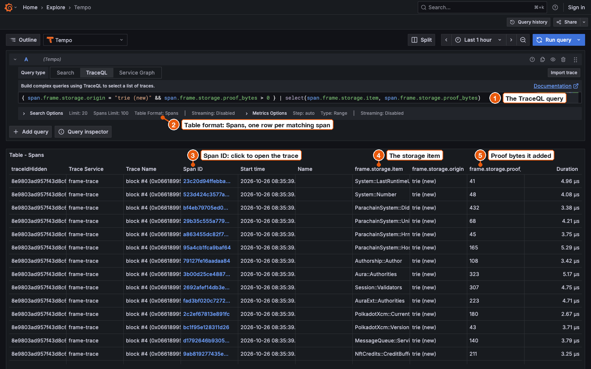

# Find storage problems with TraceQL

Find expensive reads, repeated reads and busy pallets across every block you sent to Grafana Tempo.
TraceQL is Tempo's query language: each query picks spans by their attributes.
Every query below was run against block #4 of the People fixture, and the count next to it is the real result.

You need traces in Tempo.
[Send traces to Grafana](send-traces-to-grafana.md) sets that up in two commands.
To get the same counts, send only the fixture block:

```sh
frame-trace block --offline fixtures/replay/people-traced --otlp
```

## Run a query

1. Open <http://127.0.0.1:3000/explore> and pick the **Tempo** data source.
2. Choose **TraceQL** and paste a query.
3. Open **Search Options**. Set **Table Format** to **Spans** and **Spans Limit** to `100`. The default limit shows only 3 spans per trace.
4. Press **Run query**.



1. The query.
2. **Table Format: Spans** gives one row per matching span.
3. Click a span ID to open the trace at that span.
4. `select(...)` adds attributes as columns. Here, the storage item.
5. And the [proof bytes](../concepts/proof-bytes.md) each read added.

Grafana shows at most 100 spans per trace.
To count every match in the first trace of the results, ask Tempo through Grafana:

```sh
curl -s -G http://127.0.0.1:3000/api/datasources/proxy/uid/tempo/api/search \
  --data-urlencode 'q={ span.frame.storage.duplicate_read = true }' | grep -o '"matched":[0-9]*' | head -1
```

```text
"matched":203
```

## Write a query

- frame-trace attributes are span attributes, so they start with `span.`, as in `span.frame.storage.item`.
  [Span names and attributes](../reference/spans.md) lists them with their types.
- Strings take quotes: `span.frame.storage.origin = "trie (new)"`.
- Numbers and booleans do not: `span.frame.storage.proof_bytes > 0`, `span.frame.storage.duplicate_read = true`. With quotes they match nothing.
- `name` is the span name and `duration` its length, with units such as `20us` or `1ms`.
- `=~` matches a regular expression against the whole value.
- `A >> B` finds spans matching `B` anywhere below a span matching `A`.

## Reads that cost proof bytes

**Trie reads that added proof bytes.** Reads frame-trace had to look up in the chain state and that made the proof bigger. See [Cache or trie](../concepts/cache-or-trie.md).

```text
{ span.frame.storage.origin = "trie (new)" && span.frame.storage.proof_bytes > 0 }
```

Result: 34 spans.

**Show which item and how many bytes.** The same query with columns for the storage item and the proof bytes, as in the picture above.

```text
{ span.frame.storage.origin = "trie (new)" && span.frame.storage.proof_bytes > 0 } | select(span.frame.storage.item, span.frame.storage.proof_bytes)
```

Result: 34 spans.

## Repeated reads

**Every repeated read.** Reads of a key already read in the same [phase](../concepts/phases.md). See [Find repeated reads](find-repeated-reads.md).

```text
{ span.frame.storage.duplicate_read = true }
```

Result: 203 spans.

**Blocks with more than 100 repeated reads.** `count()` counts matches per trace, so this keeps only busy blocks.

```text
{ span.frame.storage.duplicate_read = true } | count() > 100
```

Result: 1 trace, with 203 matching spans.

## One storage item or one account

**Every operation on a storage item.** Reads and writes of any account.

```text
{ span.frame.storage.item = "System::Account" }
```

Result: 83 spans.

**One account.** `frame.storage.map_keys` holds the decoded map keys, here Alice's address.

```text
{ span.frame.storage.item = "System::Account" && span.frame.storage.map_keys = "5GrwvaEF5zXb26Fz9rcQpDWS57CtERHpNehXCPcNoHGKutQY" }
```

Result: 53 spans.

## Writes per pallet

**Writes by one pallet.** `db.collection.name` is the [pallet](../reference/glossary.md#pallet) that owns the key.

```text
{ span.db.operation.name =~ "put|clear|append|clear_prefix|kill_child" && span.db.collection.name = "System" }
```

Result: 132 spans.

**Writes, grouped by pallet.** `by(...)` returns one group per pallet.

```text
{ span.db.operation.name =~ "put|clear|append|clear_prefix|kill_child" } | by(span.db.collection.name)
```

Result: 13 groups with 204 writes in total. `System` has 132, `ParachainSystem` 36, `well known keys` 19.

## Slow operations

**Storage operations slower than 20 µs.** `db.system.name = "substrate"` keeps only storage operations.

```text
{ span.db.system.name = "substrate" && duration > 20us }
```

Result: 3 spans in one run and 4 in another.
Times come from the replay on your machine, so the count changes from run to run. See [Timings](../concepts/timings.md).

## One extrinsic or one runtime call

**Reads inside one extrinsic.** Every `get` below the phase span of extrinsic 2.

```text
{ name =~ "extrinsic 2:.*" } >> { span.db.operation.name = "get" }
```

Result: 152 spans.

**Reads inside a runtime call.** Account reads made inside any `transfer_keep_alive`. Runtime calls appear only when the runtime was built with tracing. See [See runtime calls inside extrinsics](see-runtime-calls.md).

```text
{ name = "transfer_keep_alive" } >> { span.frame.storage.item = "System::Account" }
```

Result: 64 spans.

## Runtime overrides and runtime API calls

These two need other traces.
The counts come from the commands under each query.

**Traces from a runtime override.** Blocks or calls replayed with `--runtime-override`, where your Wasm ran instead of the chain's runtime.

```text
{ span.frame.runtime.override = true }
```

Result: 1 span, the block span, after this run from [See runtime calls inside extrinsics](see-runtime-calls.md#try-it-with-the-shipped-people-runtime):

```sh
frame-trace block --offline fixtures/replay/people-transfer --runtime-override people-traced.wasm --otlp
```

Add `>> { span.db.system.name = "substrate" }` to get its 421 storage operations.

**Runtime API call traces.** Traces from `frame-trace call`.

```text
{ span.frame.trace.kind = "call" }
```

Result: 1 span after this run:

```sh
frame-trace call --offline fixtures/replay/call-people-nonce --otlp
```

## Root check failures

There is no query for them, because spans do not carry the [root check](../concepts/what-a-replay-proves.md) result.
frame-trace prints it as the `root check:` line and writes it to JSON as [`execution.root_check`](../reference/json.md#execution).
When a block's own runtime finds a wrong root, it aborts, and frame-trace exports nothing.
See [Troubleshooting](../troubleshooting.md#runtime-execution-failed-root-mismatch-unsupported-host-function-or-invalid-block).
