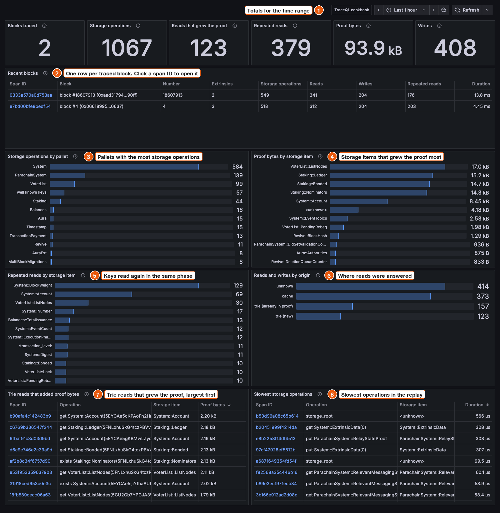
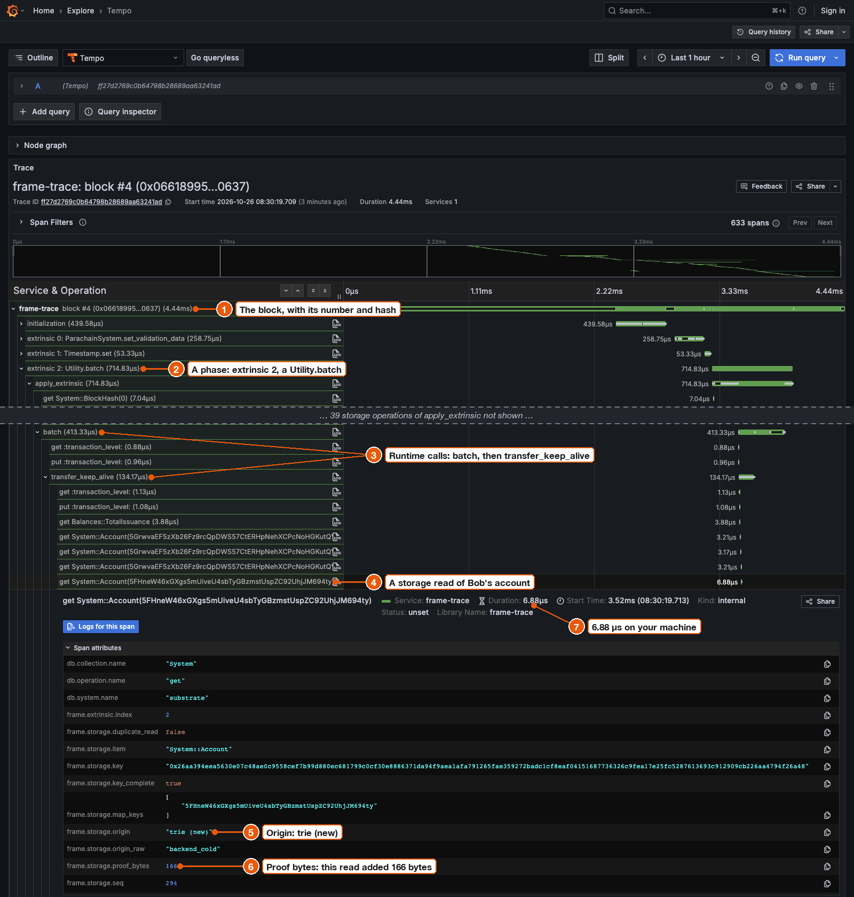

# Send traces to Grafana

Open a block's storage reads and writes in Grafana, with a ready dashboard and TraceQL search.
This is the recommended setup: it uses `grafana/otel-lgtm`, the same image Parity uses for its own local tracing.

You need frame-trace [installed](../getting-started/install.md), Docker, and a copy of the frame-trace repository for the example files.

## 1. Start Grafana

Run this from the `frame-trace` directory:

```sh
cd examples/grafana-lgtm
docker compose up -d
```

The first start downloads a 535 MB image, which took 27 seconds on a fast connection.
After that, Grafana and Tempo are ready in about 3 seconds.

| Port | What |
| --- | --- |
| 3000 | Grafana |
| 4318 | OTLP/HTTP, where frame-trace sends traces |

> **Warning:** Grafana opens without a login, as a viewer that can use Explore. Use this on your own machine only.

## 2. Send a trace

Go back to the `frame-trace` directory and replay the People block that ships with the repository:

```sh
cd ../..
frame-trace block --offline fixtures/replay/people-traced --otlp
```

```text
replay #4: loading runtime and preparing state
root check: PASS; RPC calls: 0 (timed replay: 0); execution proof: 6586 bytes
fetching state #4: 0 proof request rounds; 0 RPC calls
state root: computed 0x47116eac39ac59ba0534a0e4d624f78c4c8c56af5c3084e71c98ca1811e6e4f1; header 0x47116eac39ac59ba0534a0e4d624f78c4c8c56af5c3084e71c98ca1811e6e4f1
exported 633 spans to http://127.0.0.1:4318
```

`exported 633 spans` means Grafana's collector accepted every [span](../reference/glossary.md#span-and-trace).
The trace can be searched about a second later.

A live block works the same way:

```sh
frame-trace block --rpc wss://westend-asset-hub-rpc.polkadot.io --block finalized --otlp
```

## 3. Open the dashboard

Open <http://127.0.0.1:3000>.
The `frame-trace` dashboard opens.
It shows every block you traced in the last hour.



1. Totals for the time range: blocks, storage operations, reads that added [proof bytes](../concepts/proof-bytes.md), repeated reads, proof bytes and writes.
2. One row per block. Click a span ID to open that block's trace.
3. The [pallets](../reference/glossary.md#pallet) whose keys were read or written most.
4. The storage items that added the most proof bytes. `<unknown>` holds operations without a storage item, such as `storage_root`.
5. Keys read again in the same [phase](../concepts/phases.md). See [Find repeated reads](find-repeated-reads.md).
6. Where operations were answered: [cache or trie](../concepts/cache-or-trie.md). Writes show as `unknown`.
7. Every read that went to the trie and added proof bytes, largest first.
8. Storage operations that took more than 20 µs, slowest first. These times come from the replay on your machine, not from a node. See [Timings](../concepts/timings.md).

The numbers and bar charts can take up to a minute to include a new block.
The tables show it at once.
Keep the time range at 3 hours or less: Tempo refuses longer ranges for the counts and bar charts.

## 4. Open a trace

In the **Recent blocks** table, click the span ID of `block #4 (0x06618995…0637)`.
Or go to **Explore**, pick **Tempo**, choose **TraceQL**, paste the trace ID and press **Run query**.

To get the view below, click the double up arrow next to **Service & Operation** to collapse everything.
Then open `block #4`, `extrinsic 2: Utility.batch`, `apply_extrinsic`, `batch` and the first `transfer_keep_alive`.
Click the first read of `System::Account(5FHn…94ty)`, then **Span attributes**.



1. The block span, with its number and a short hash.
2. A phase: extrinsic 2, a `Utility.batch`.
3. Runtime calls: `batch`, then the first `transfer_keep_alive`. You see these because this block's runtime was built with tracing. See [See runtime calls inside extrinsics](see-runtime-calls.md).
4. A read of Bob's account, `System::Account(5FHn…94ty)`.
5. `frame.storage.origin`: `trie (new)`, so frame-trace looked it up in the chain state and it was not in the proof yet.
6. `frame.storage.proof_bytes`: this read added 166 bytes to the block's proof.
7. The read took 6.88 µs in the replay on your machine.

[Span names and attributes](../reference/spans.md) lists every attribute.

## 5. Search with TraceQL

TraceQL finds spans by attribute across every block you sent.
For example, this finds the 34 reads in block #4 that went to the trie and added proof bytes:

```text
{ span.frame.storage.origin = "trie (new)" && span.frame.storage.proof_bytes > 0 }
```

[Find storage problems with TraceQL](query-traces-in-grafana.md) has more queries, each checked against this block.

## 6. Stop

From `examples/grafana-lgtm`:

```sh
docker compose down
```

The container keeps traces inside itself, so stopping it deletes them.

## Use your own Grafana

Import `examples/grafana-lgtm/dashboards/frame-trace.json` into any Grafana that has a Tempo data source with the UID `tempo`.
The counts and bar charts use TraceQL metrics, so Tempo must answer metrics queries.
The LGTM image and the [Alloy example](send-traces-through-alloy.md) both do.
